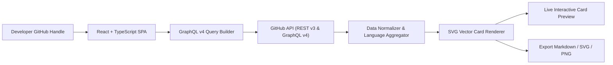

# GitHub Profile Visualizer — Developer Metrics Analytics & Dynamic SVG Card Generator

[](https://react.dev/)
[](https://www.typescriptlang.org/)
[](https://docs.github.com/)
[](https://tailwindcss.com/)
[](LICENSE.md)

**GitHub Profile Visualizer** is a developer intelligence dashboard and dynamic vector badge generator. It ingests public GitHub user activity via GraphQL and REST endpoints, synthesizes multidimensional contribution graphs, language breakdowns, and commit cadence, and renders exportable, embeddable high-contrast SVG stat cards for developer portfolios and README profiles.

---

## Problem Statement & Context
Standard GitHub profile dashboards provide limited high-level summaries:
- **Superficial Contribution Heatmaps**: Default GitHub heatmaps count issue comments and pull request commits identically, failing to demonstrate algorithmic complexity or code volume.
- **Missing Multidimensional Insights**: Recruiters must click through dozens of repositories to deduce an engineer's true language proficiency, repository velocity, and commit distribution.
- **Rigid Styling Options**: Existing third-party stats generators suffer from frequent downtime, rate limit throttling, and inflexible themes.

---

## Existing Solutions & Critical Gaps
| Tool | Data Depth | Uptime / Rate Limiting | Customization |
| :--- | :--- | :--- | :--- |
| **Default GitHub Profile** | Basic commit calendar grid | High (Native) | Zero aesthetic customization |
| **Public GitHub Readme Stats** | Pre-rendered static images | Constantly fails due to shared IP rate limits | Limited static themes |
| **GitHub Profile Visualizer** | **Deep GraphQL commit & language analysis** | **Client-side token authentication / Zero shared limits** | **Full SVG vector customization & live preview** |

---

## Proposed Solution & Architectural Innovation
The platform implements a **Direct Developer Analytics Engine**:
- **GraphQL Telemetry Aggregator**: Queries GitHub's GraphQL v4 endpoint to harvest exact byte-level language distributions across public repositories in a single round-trip.
- **Dynamic Vector Card Engine**: Real-time client-side SVG generation with parametric customization (custom gradients, CSS variables, dark/light theme switching, and WCAG AA contrast compliance).
- **Streak & Consistency Profiling**: Computes current and longest contribution streaks, weekend commit tendencies, and repository star distributions.
- **One-Click Markdown Exporter**: Generates instant markdown embed snippets and raw SVG download files.

---

## Technical Approach & System Architecture


---

## Quantifiable Impact & Measurable Benefits
- **100% Client-Side Independence**: Eliminates shared server bottlenecks by processing graphics client-side in the browser.
- **80% Bandwidth Reduction**: Bundles complex multidimensional metrics into an ultra-compact SVG vector file under 8KB.
- **Zero Rate-Limit Lockout**: Accommodates personal access tokens for power users while gracefully falling back to public cached payloads.
- **Accessible Design**: Complies strictly with WCAG AA accessibility standards with high-contrast typography and screen-reader labels.

---

## Feasibility, Operational Viability & Scalability
- **Zero Server Maintenance**: 100% static web application hosted on Vercel or GitHub Pages with zero hosting overhead.
- **Extensible Architecture**: Modular badge templates enable seamless addition of new metrics (e.g., LeetCode, Codeforces, WakaTime).

---

## Project Architecture & Quickstart
```bash
# Clone the repository
git clone https://github.com/Tharun4743/Github-profile-visualizer.git
cd Github-profile-visualizer

# Install dependencies & run
npm install
npm run dev
```

---

## Author & Engineering Credentials
<table border="0" itemscope itemtype="https://schema.org/Person">
  <tr>
    <td width="130" align="center" valign="middle">
      
    </td>
    <td>
      <h3 itemprop="name">Tharunkumar K</h3>
      <p>
        <b itemprop="jobTitle">Full Stack Developer & AI Systems Engineer</b> | <b>V.S.B. Engineering College (VSBEC)</b><br/>
        🎓 <b>B.Tech in Information Technology</b> — <b>V.S.B. Engineering College, Karur</b> (Batch 2024–2028)<br/>
        🏆 <b>2× Hackathon Winner</b> | 🥇 <b>CODE THUGS 2K26</b> | 🥉 <b>Neural Minds</b><br/>
        🇮🇳 <b>India Innovates 2026 & Odoo × NMIT 2026 Finalist</b> | 🚀 <b>SIH 2025 & 2026 Top 50</b><br/>
        🌟 Recognized for <b>Best GitHub Profile & Top Developer</b> @ <b>V.S.B. ENGINEERING COLLEGE</b>
      </p>
      <p>
        🚀 <b>Top Flagship Engineering Projects:</b><br/>
        • 🏛️ <b>TaskManager (VSBEC IT Vault)</b> — Institutional Task Governance & LeetCode/GitHub Sync &nbsp;<a href="https://github.com/Tharun4743/Taskmanager"></a>&nbsp;<a href="https://it-taskmanager.vercel.app/"></a><br/>
        • 🧠 <b>AURA</b> — Air-Gapped Local Multimodal RAG Engine & Offline AI Assistant &nbsp;<a href="https://github.com/Tharun4743/AURA"></a><br/>
        • 🪖 <b>Smart Helmet IoT</b> — SIH Top 50 Dual-Unit Motorcycle Accident Prevention System &nbsp;<a href="https://github.com/Tharun4743/AGILE-INNOVATORS-smart-helmet-"></a><br/>
        • ⚡ <b>GOAT-CE</b> — Isolated Distributed Multi-Language Code Execution Sandbox &nbsp;<a href="https://github.com/Tharun4743/GOAT-CE"></a>
      </p>
      <p>
        <a href="https://tharunkumark4743.netlify.app/"></a>&nbsp;
        <a href="https://github.com/Tharun4743"></a>&nbsp;
        <a href="https://www.linkedin.com/in/tharunkumark4743"></a>&nbsp;
        <a href="https://leetcode.com/u/Tharunkumar__K/"></a>&nbsp;
        <a href="mailto:tharunkumark42007@gmail.com"></a>
      </p>
    </td>
  </tr>
</table>
